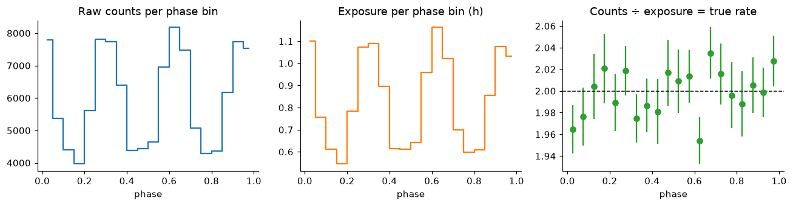
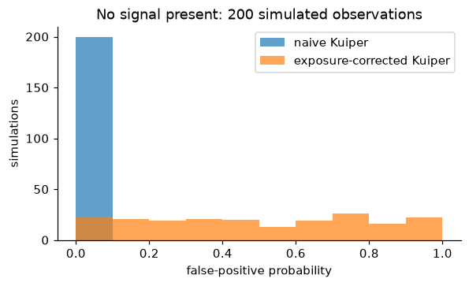

# phasecover

**Exposure-corrected searches for periodic signals in gappy photon data, built on [Astropy](https://www.astropy.org).**

X-ray and gamma-ray telescopes in low Earth orbit lose sight of their target for part of every ~96-minute orbit. When you look for a signal that repeats every few hours (an orbiting binary star, a slow pulsar), those gaps mean some phases of the cycle are observed more than others. Standard tests that assume even coverage then **"detect" the observing pattern instead of the source**.

`phasecover` folds the observation's good time intervals onto the trial cycle, builds the distribution an unmodulated source *should* produce, and tests the photons against that instead.



*A constant source, folded at 5 hours. Raw counts (left) look strongly modulated, but only because the exposure (middle) is uneven. Dividing it out recovers the true constant rate (right).*

## Key result

200 simulated observations of a source with **no signal**:

| Test | Claimed detections (fpp < 0.01) |
|---|---|
| Kuiper vs uniform (naive) | **100%** |
| Kuiper vs exposure-corrected CDF | **0%** |



The corrected test still finds real signals: a 3% modulation is detected with false-positive probability ~10⁻¹⁵.

## What it uses from Astropy

| Task | Astropy |
|---|---|
| Phase coverage of observing windows | `stats.fold_intervals`, `stats.cdf_from_intervals`, `stats.histogram_intervals` |
| Modulation tests | `stats.kuiper`, `stats.rayleightest` |
| Light curves and period search | `timeseries.BinnedTimeSeries`, `timeseries.LombScargle` |
| Event files (OGIP `EVENTS` + `GTI`) | `io.fits`, `table.Table`, `time.Time` (`MJDREFI`/`MJDREFF`, TT) |
| Units throughout | `astropy.units`: pass `5 * u.hour` or plain seconds |

## Install

```bash
git clone https://github.com/ShubhamX57/phasecover.git
cd phasecover
pip install -e ".[test,plot]"
pytest
```

## Usage

```python
import astropy.units as u
import phasecover as pc

events = pc.read_events("ni1234567890_cl.evt")        # any OGIP event file
result = pc.modulation_test(events.times, events.gtis, 5 * u.hour)
print(result.summary())

phase, rate, err, exposure = pc.folded_profile(events.times, events.gtis, 5 * u.hour)
```

Command line:

```bash
phasecover simulate obs.fits --pulsed-fraction 0.03 --seed 1
phasecover analyze obs.fits --period 5 --plot profile.png
```

See [`notebooks/walkthrough.ipynb`](notebooks/walkthrough.ipynb) for the full analysis: simulation, the false-detection problem, Monte Carlo calibration, weak-signal detection, Lomb–Scargle period search (including gap aliases), and FITS round-trips.

## Upstream contribution

This project relies on `astropy.stats.fold_intervals`. In Astropy ≤ 8.0.x that function loses one full cycle of coverage for any window ending exactly on a cycle boundary. A single complete cycle gets zero exposure, and `cdf_from_intervals` then raises an error. I submitted a fix for this upstream: [astropy/astropy#20671](https://github.com/astropy/astropy/pull/20671).

`phasecover` probes for the faulty behaviour at import time and corrects for it, so results are right on both old and fixed Astropy versions. The test suite passes on both.

## Project layout

```
src/phasecover/
  simulate.py   low-Earth-orbit visibility gaps and modulated photon events
  io.py         OGIP event-file reading/writing
  exposure.py   phase coverage via astropy.stats.fold_intervals
  search.py     Kuiper/Rayleigh tests, folded profiles, light curves, Lomb–Scargle
  cli.py        `phasecover simulate` / `phasecover analyze`
tests/          pytest suite (19 tests)
notebooks/      executed walkthrough
```

## Limitations

- The Kuiper false-positive probability is an asymptotic approximation; for small event counts, calibrate by simulation (as in the notebook).
- Event times are assumed to be already barycentred; no barycentric correction is applied.
- Period search uses a binned Lomb–Scargle periodogram; for fast pulsars, an unbinned Z²ₙ or H-test would be more appropriate.

## License

BSD-3-Clause
